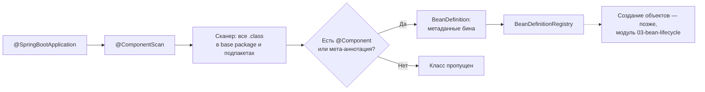
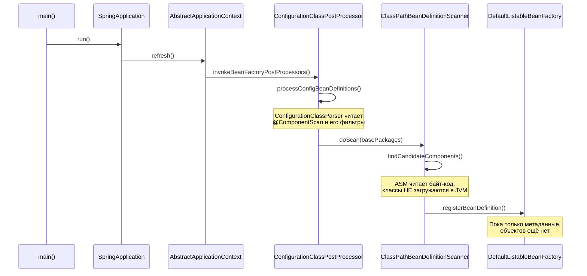

# 01. Component Scan: как Spring находит ваши классы

**Что показывает модуль:** что происходит между аннотацией `@SpringBootApplication` и моментом, когда контейнер «знает» о ваших `@Component`, `@Service` и `@Repository`.

---

## Концепция

`@SpringBootApplication` — это три аннотации в одной: `@Configuration`, `@EnableAutoConfiguration` и `@ComponentScan`. Здесь разбираем только третью.

`@ComponentScan` без параметров сканирует пакет, в котором лежит класс с `main()`, и все его подпакеты. Сканер проходит по `.class`-файлам и отбирает те, что помечены `@Component` **или аннотацией, которая сама помечена `@Component`** (мета-аннотация): `@Service`, `@Repository`, `@Controller`, `@Configuration`.



Три факта, которые обычно и есть «магия»:

1. **Сканер не загружает классы в JVM.** Он читает байт-код через библиотеку ASM и смотрит только на аннотации в метаданных файла. Поэтому сканирование быстрое и не выполняет статические инициализаторы.
2. **Результат сканирования — не объекты, а `BeanDefinition`**: «чертежи» бинов (класс, scope, имя). Объекты появятся на следующих этапах.
3. **Имя бина по умолчанию** — имя класса с маленькой буквы: `NotificationService` → `notificationService`. `@Component("renamedComponent")` переопределяет его.

## Запуск

```bash
mvn spring-boot:run
```

Приложение без веб-сервера: поднимается контекст, `ScanReportRunner` печатает отчёт, JVM завершается. Ожидаемый вывод:

```text
================ ОТЧЁТ СКАНИРОВАНИЯ ================
Бины, найденные сканированием пакета com.visualsb.componentscan:
  componentScanApplication -> com.visualsb.componentscan.ComponentScanApplication
  notificationRepository   -> com.visualsb.componentscan.repository.NotificationRepository
  notificationService      -> com.visualsb.componentscan.service.NotificationService
  plainComponent           -> com.visualsb.componentscan.component.PlainComponent
  renamedComponent         -> com.visualsb.componentscan.component.NamedComponent
  scanReportRunner         -> com.visualsb.componentscan.ScanReportRunner
Бин 'internalComponent' в контексте: ОТСУТСТВУЕТ (исключён exclude-фильтром)
Всего bean definitions: 57 (остальные — инфраструктура Spring Boot)
====================================================
```

Число bean definitions зависит от версии Spring Boot и способа запуска (в тестовом контексте их чуть больше) — ориентируйтесь на список своих бинов, а не на это число.

Обратите внимание: `NamedComponent` попал в контекст под именем `renamedComponent`, а `InternalComponent` не попал вовсе — его пакет исключён фильтром в `ComponentScanApplication`.

## Тест

```bash
mvn test
```

`ComponentScanApplicationTests` проверяет четыре утверждения: стереотипы находятся (включая мета-аннотации), имена по умолчанию decapitalized, явное имя переопределяет дефолтное, exclude-фильтр работает.

## Под капотом

Модуль собран на Spring Boot 3.5.x (Spring Framework 6.2.x). Номера строк в исходниках зависят от версии, поэтому точки останова указаны по классу и методу.

### Стек вызовов



### Точки останова

| Класс / метод | Что наблюдать |
|---|---|
| `ConfigurationClassPostProcessor#processConfigBeanDefinitions` | Точка входа: обработка всех `@Configuration`-классов |
| `ComponentScanAnnotationParser#parse` | Атрибуты `@ComponentScan`: basePackages, excludeFilters |
| `ClassPathBeanDefinitionScanner#doScan` | Возвращает набор `BeanDefinition` — результат сканирования |
| `ClassPathScanningCandidateComponentProvider#isCandidateComponent` | Решение «подходит / не подходит» по каждому классу |
| `DefaultListableBeanFactory#registerBeanDefinition` | Финальная регистрация: имя → `BeanDefinition` |

Как дебажить: откройте `ComponentScanApplication` в IntelliJ IDEA, поставьте брейкпоинты в исходниках Spring (IDEA скачает их по «Download Sources») и запустите `main()` в режиме Debug.

### Тонкость с exclude-фильтром

В примере `@ComponentScan` объявлен прямо на классе рядом с `@SpringBootApplication`. Прямая аннотация **замещает** ту, что встроена в `@SpringBootApplication`, поэтому фильтр применяется. Это общее правило Spring: аннотация на классе важнее мета-аннотации.

### Магия в логах

Раскомментируйте в `application.properties`:

```properties
logging.level.org.springframework.context.annotation.ClassPathScanningCandidateComponentProvider=DEBUG
```

В логе появится строка `Identified candidate component class` для каждого найденного класса — видно работу сканера без дебаггера.

## Эксперименты

1. Уберите `excludeFilters` из `@ComponentScan` — `internalComponent` появится в отчёте, а тест `excludeFilterSkipsPackage` упадёт.
2. Добавьте класс без аннотации в пакет `service` — сканер его проигнорирует.
3. Снимите `@Service` с `NotificationService` — бин исчезнет из контекста.
4. Переименуйте бин в `@Component("...")` и посмотрите, как изменится отчёт.

## Ключевые классы

- `ClassPathBeanDefinitionScanner` — сканер пакетов.
- `ClassPathScanningCandidateComponentProvider` — отбор кандидатов по аннотациям (ASM).
- `BeanDefinition` / `BeanDefinitionRegistry` — метаданные бина и их хранилище.
- `ConfigurationClassPostProcessor` — тот, кто запускает весь процесс.

## Дальше

`02-bean-definition`: из чего состоит `BeanDefinition` и почему контейнер работает с метаданными, а не с классами.
