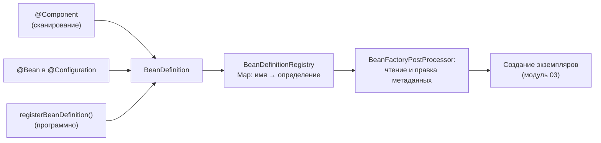
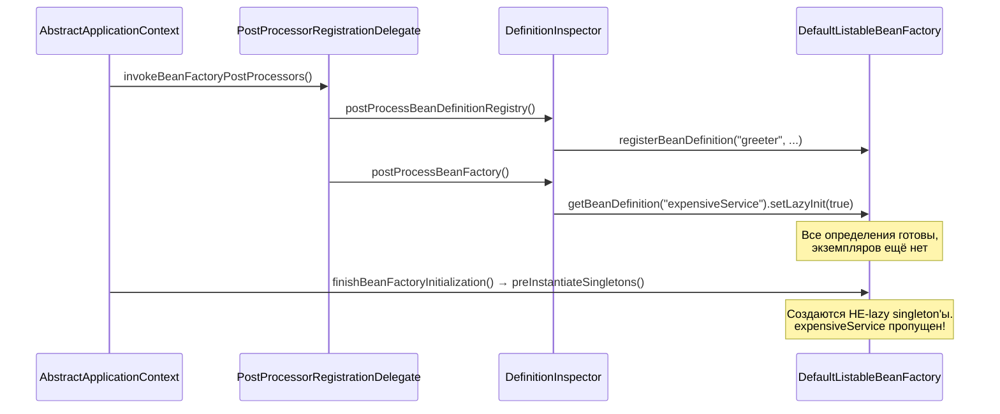

# 02. BeanDefinition: контейнер работает с метаданными, а не с объектами

**Что показывает модуль:** что такое `BeanDefinition`, откуда берутся определения бинов (сканирование, `@Bean`, программная регистрация) и почему их можно читать и менять **до** создания экземпляров.

---

## Концепция

После сканирования (модуль 01) контейнер не создаёт объекты — он складывает в реестр «чертежи»: `BeanDefinition`. В чертеже записано: какой класс инстанцировать, какой scope, ленивый ли бин, от чего зависит. Объект появится позже, когда контейнер дойдёт до фазы создания бинов (или когда бин кто-то запросит).



Три следствия, которые и есть «магия под капотом»:

1. **Бин можно зарегистрировать без единой аннотации.** `Greeter` в примере — обычный класс, контейнер узнал о нём через `registry.registerBeanDefinition("greeter", new RootBeanDefinition(Greeter.class))`.
2. **Тип определения выдаёт происхождение бина:** `ScannedGenericBeanDefinition` (сканирование), `ConfigurationClassBeanDefinition` (`@Bean`), `RootBeanDefinition` (программная регистрация).
3. **Метаданные можно менять до инстанцирования.** `DefinitionInspector` ставит `lazyInit=true` бину `expensiveService` — и его конструктор не вызывается при старте, хотя без этой правки вызвался бы.

## Запуск

```bash
mvn spring-boot:run
```

В логе при старте (ещё до создания бинов) появятся строки `DefinitionInspector`:

```text
>>> [registry] 'greeter' зарегистрирован программно: RootBeanDefinition. Экземпляра ещё нет — только метаданные.
>>> [beanFactory] 'expensiveService': метаданные изменены -> lazyInit=true. Объект не будет создан при старте.
```

Затем `DefinitionReportRunner` печатает отчёт:

```text
================ BEAN DEFINITIONS ================
  Имя                Тип определения                    scope      lazy
  greeter            RootBeanDefinition                 singleton  false
  expensiveService   ScannedGenericBeanDefinition       singleton  true
  timeProvider       ConfigurationClassBeanDefinition   singleton  false
Экземпляр expensiveService создан при старте? false

Запрашиваю expensiveService из контекста...
>>> ExpensiveService: конструктор вызван, экземпляр создан
Ответ бина: работа выполнена
==================================================
```

Ключевой момент: конструктор `ExpensiveService` вызывается **только после** `getBean` — метаданные сработали.

## Тест

```bash
mvn test
```

`BeanDefinitionApplicationTests` проверяет: программный бин без аннотаций работает, тип определения соответствует источнику, `lazyInit` реально откладывает создание (`containsSingleton` false → getBean → true), scope по умолчанию — singleton. Lazy-поведение проверяется на отдельном чистом контексте (`AnnotationConfigApplicationContext`): в основном приложении `DefinitionReportRunner` сам запрашивает бин при старте, поэтому «не создан» там уже не проверить.

## Под капотом

Spring Boot 3.5.x (Spring Framework 6.2.x). Точки останова — по классу и методу.

### Где это происходит в refresh()

`AbstractApplicationContext#refresh` — главный сценарий запуска контекста. Нас интересуют два шага, идущие в строгом порядке:



### Точки останова

| Класс / метод | Что наблюдать |
|---|---|
| `DefaultListableBeanFactory#registerBeanDefinition` | Заполнение `beanDefinitionMap`: имя → определение |
| `DefinitionInspector#postProcessBeanDefinitionRegistry` | Наш бин без аннотаций; в этой фазе экземпляров ещё нет |
| `DefaultListableBeanFactory#preInstantiateSingletons` | Цикл по именам определений; lazy-бины пропускаются |
| `AbstractBeanDefinition` | Поля чертежа: `beanClass`, `scope`, `lazyInit`, `dependsOn`, `autowireCandidate` |

### Что ещё хранит BeanDefinition

Помимо показанных: `dependsOn` (порядок создания), `primary`, `fallback`, `autowireCandidate` (участвует ли в внедрении по типу), `constructorArgumentValues` и `propertyValues` (аргументы для создания), `initMethodName`/`destroyMethodName`. Всё это читается и правится до создания объекта.

Тонкость, видимая в отладчике: у `RootBeanDefinition` и `ConfigurationClassBeanDefinition` поле `scope` по умолчанию — **пустая строка**, а не `"singleton"` (поэтому в отчёте мы подставляем `singleton` вручную). Пустой scope трактуется контейнером как singleton.

## Эксперименты

1. Закомментируйте `setLazyInit(true)` в `DefinitionInspector` — конструктор `ExpensiveService` вызовется при старте, а тест `lazyMetadataPreventsInstantiationAtStartup` упадёт.
2. Зарегистрируйте второй `RootBeanDefinition` под именем `greeter` — получите `BeanDefinitionOverrideException`: Spring Boot по умолчанию запрещает перезапись определений.
3. Поменяйте scope: `definition.setScope("prototype")` для `greeter` — каждый `getBean` вернёт новый объект, тест `defaultScopeIsSingleton` упадёт.
4. Поставьте брейкпоинт в `preInstantiateSingletons` и посмотрите, сколько бинов создаётся при старте и в каком порядке.

## Ключевые классы

- `BeanDefinition` / `RootBeanDefinition` — чертёж бина и его основная реализация.
- `BeanDefinitionRegistry` — реестр определений (реализует `DefaultListableBeanFactory`).
- `BeanDefinitionRegistryPostProcessor` — точка расширения: добавить свои определения.
- `BeanFactoryPostProcessor` — точка расширения: прочитать/изменить чужие определения.

## Дальше

`03-bean-lifecycle`: как из чертежа получается объект — instantiate → populate → init, и где в этом процессе срабатывают `BeanPostProcessor`'ы.
