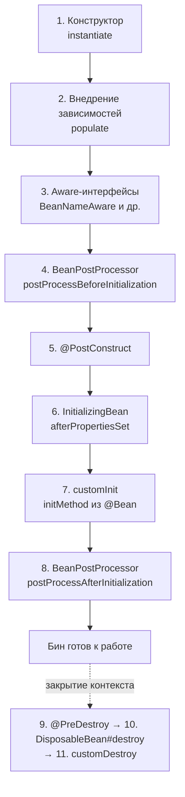
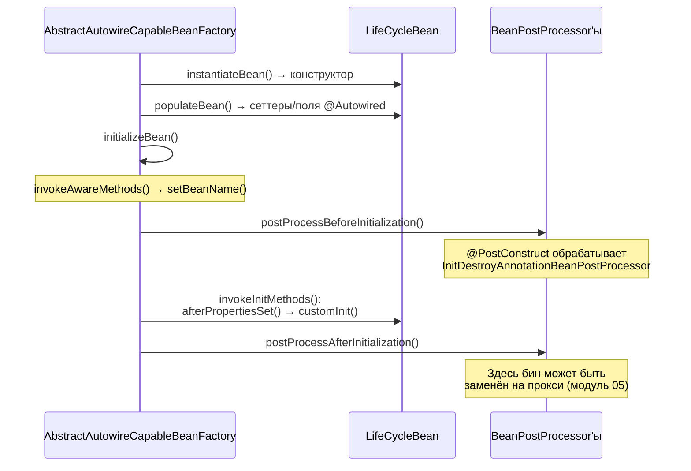

# 03. Жизненный цикл бина: от конструктора до destroy

**Что показывает модуль:** все 8 событий инициализации бина в точном порядке и 3 события уничтожения. Каждое событие фиксируется в `LifecycleLog`, поэтому порядок проверяется тестом, а не на веру.

---

## Концепция

Из чертежа (`BeanDefinition`, модуль 02) контейнер делает живой объект не в один шаг, а по конвейеру. На конвейере есть точки, куда можно «вклиниться» своим кодом:



Зачем это знать на практике:

- В **конструкторе** зависимости ещё не внедрены — поэтому `@PostConstruct` существует: работа с зависимостями начинается там.
- **`BeanPostProcessor` видит каждый бин** и может вернуть другой объект — так работают прокси для `@Transactional` (модуль 05).
- Порядок `@PostConstruct` → `afterPropertiesSet` → `customInit` фиксирован спецификацией, а не «как повезёт».

В примере `LifeCycleBean` создаётся через `@Bean(initMethod = "customInit", destroyMethod = "customDestroy")`, чтобы на одном бине были видны все три способа задать init/destroy.

## Запуск

```bash
mvn spring-boot:run
```

События 1–8 печатаются ещё до строчки `Started BeanLifecycleApplication`:

```text
>>> 1. Конструктор: экземпляр создан (instantiate)
>>> 2. Сеттер-инъекция: зависимости внедрены (populate)
>>> 3. BeanNameAware: бин узнал своё имя 'lifeCycleBean'
>>> 4. BeanPostProcessor#postProcessBeforeInitialization
>>> 5. @PostConstruct
>>> 6. InitializingBean#afterPropertiesSet
>>> 7. customInit: initMethod из @Bean
>>> 8. BeanPostProcessor#postProcessAfterInitialization — бин полностью инициализирован

=== КОНТЕКСТ ГОТОВ: бин 'lifeCycleBean' готов, collaborator = Collaborator
События 1–8 выше произошли ДО готовности контекста.
При завершении JVM сработают @PreDestroy -> destroy -> customDestroy (строки ниже).

>>> 9. @PreDestroy: контекст закрывается
>>> 10. DisposableBean#destroy
>>> 11. customDestroy: destroyMethod из @Bean
```

Приложение без веб-сервера завершается сразу после раннера, и при выходе JVM срабатывает shutdown hook Spring — поэтому события уничтожения видны сразу, ничего нажимать не нужно.

## Тест

```bash
mvn test
```

Первый тест проверяет готовый бин в полном контексте. Второй поднимает отдельный `AnnotationConfigApplicationContext` и проверяет **точный порядок** всех 11 событий через `LifecycleLog` — включая destroy после `close()`.

## Под капотом

Spring Boot 3.5.x (Spring Framework 6.2.x). Точки останова — по классу и методу.

### Всё происходит в doCreateBean

Создание одного бина — это `AbstractAutowireCapableBeanFactory#doCreateBean`:



### Точки останова

| Класс / метод | Что наблюдать |
|---|---|
| `AbstractAutowireCapableBeanFactory#doCreateBean` | Три фазы: instantiate → populate → initialize |
| `AbstractAutowireCapableBeanFactory#invokeAwareMethods` | Вызов `BeanNameAware`, `BeanClassLoaderAware`, `BeanFactoryAware` |
| `AbstractAutowireCapableBeanFactory#invokeInitMethods` | Порядок: `afterPropertiesSet`, затем custom `initMethod` |
| `InitDestroyAnnotationBeanPostProcessor#postProcessBeforeInitialization` | Так работает `@PostConstruct` — это обычный BeanPostProcessor |
| `DisposableBeanAdapter#destroy` | Порядок уничтожения: `@PreDestroy` → `destroy()` → custom destroyMethod |

### Магия внутри магии

`@PostConstruct` и `@PreDestroy` — не отдельный механизм контейнера, а работа обычного `BeanPostProcessor` (`InitDestroyAnnotationBeanPostProcessor`). Он вызывает `@PostConstruct` на шаге before-initialization и регистрирует уничтожение. Точно так же устроены `@Autowired`, `@Scheduled` и большинство «волшебных» аннотаций — это следующий модуль.

### Почему BeanPostProcessor с фильтром

`LifecyclePostProcessor` вызывается для **каждого** бина контекста, поэтому в нём стоит фильтр `instanceof LifeCycleBean`. Уберите фильтр — и увидите десятки вызовов на инфраструктурных бинах Spring Boot.

### Предупреждение BeanPostProcessorChecker — это нормально

В логе виден WARN: `Bean 'lifecycleLog' ... is not eligible for getting processed by all BeanPostProcessors`. Постпроцессоры создаются раньше остальных бинов, а наш `LifecyclePostProcessor` в конструкторе требует `LifecycleLog` — поэтому лог создаётся досрочно и не проходит часть постпроцессоров. Для простого логгера это безопасно. В реальном коде зависимости BeanPostProcessor принято оборачивать в `@Lazy` или `ObjectProvider`, чтобы не тащить бины в раннюю фазу.

## Эксперименты

1. Уберите фильтр `instanceof` из `LifecyclePostProcessor` — посчитайте, для скольких бинов вызвался процессор.
2. Перенесите логику из `postConstruct()` в конструктор — увидите, почему там нельзя работать с `collaborator` (он ещё null).
3. Уберите `customInit` из `@Bean(initMethod=...)` — событие 7 исчезнет, тест упадёт с несовпадением порядка.
4. Поставьте брейкпоинт в `initializeBean` и пройдите шагами по одному бину — увидите весь конвейер за минуту.

## Ключевые классы

- `AbstractAutowireCapableBeanFactory` — фабрика, выполняющая создание бина.
- `BeanPostProcessor` — главная точка расширения до/после инициализации.
- `InitializingBean` / `DisposableBean` — интерфейсные callback'и.
- `InitDestroyAnnotationBeanPostProcessor` — реализация `@PostConstruct`/`@PreDestroy`.

## Дальше

`04-beanpostprocessor`: пишем свой процессор, который изменяет бины, и смотрим, какие аннотации Spring устроены именно так.
