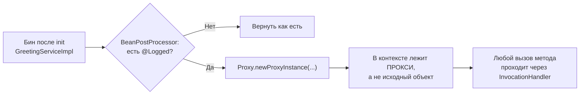
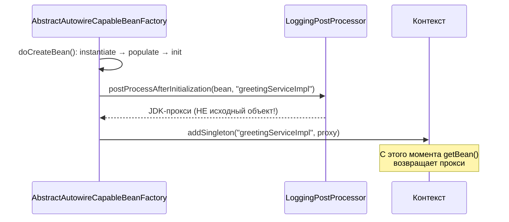

# 04. BeanPostProcessor: точка расширения, где живёт магия

**Что показывает модуль:** как один интерфейс позволяет вмешаться в создание любого бина. Своя аннотация `@Logged` заставляет постпроцессор подменить бин JDK-проксом с логированием, а отчёт показывает, что `@Autowired` и `@PostConstruct` внутри Spring работают через тот же механизм.

---

## Концепция

Из модуля 03 вы знаете: после инициализации бина контейнер вызывает `postProcessAfterInitialization` у всех зарегистрированных `BeanPostProcessor`'ов. Ключевая деталь: **процессор возвращает объект, который попадёт в контекст**. Это может быть тот же бин — или совсем другой объект.



Именно так работают `@Transactional`, `@Async`, `@Cacheable`: постпроцессор (в их случае — авто-проксировщик Spring AOP) заменяет ваш бин прокси. Наш `@Logged` — та же идея в миниатюре, без библиотек AOP.

## Запуск

```bash
mvn spring-boot:run
```

При старте видно, как процессор подменяет бин:

```text
>>> [bpp] бин 'greetingServiceImpl' помечен @Logged — возвращаю JDK-прокси вместо исходного объекта
```

Затем раннер печатает все постпроцессоры контекста и вызывает метод через прокси (номер прокси и время меняются от запуска к запуску):

```text
================ BeanPostProcessor'Ы КОНТЕКСТА ================
   1. org.springframework.context.support.ApplicationContextAwareProcessor
   2. org.springframework.context.annotation.ConfigurationClassPostProcessor$ImportAwareBeanPostProcessor
   3. org.springframework.context.support.PostProcessorRegistrationDelegate$BeanPostProcessorChecker
   4. org.springframework.boot.context.properties.ConfigurationPropertiesBindingPostProcessor
   5. org.springframework.aop.framework.autoproxy.InfrastructureAdvisorAutoProxyCreator
   6. com.visualsb.beanpostprocessor.LoggingPostProcessor
   7. org.springframework.context.annotation.CommonAnnotationBeanPostProcessor
   8. org.springframework.beans.factory.annotation.AutowiredAnnotationBeanPostProcessor
   9. org.springframework.context.support.ApplicationListenerDetector

Класс бина greetingService в runtime: jdk.proxy2.$Proxy31
Это JDK-прокси? true

Вызов greetingService.greet("мир"):
>>> [proxy] вызов greet()
>>> [proxy] завершён за 589 мкс
Ответ: Привет, мир!
===============================================================
```

В списке постпроцессоров обратите внимание на знакомые имена: `AutowiredAnnotationBeanPostProcessor`, `CommonAnnotationBeanPostProcessor` — и наш `LoggingPostProcessor` среди них.

## Тест

```bash
mvn test
```

Проверяется: бин в контексте — действительно JDK-прокси (а не `GreetingServiceImpl`), прокси корректно делегирует вызовы настоящей реализации, а в списке постпроцессоров присутствуют и «волшебные» процессоры Spring, и наш.

## Под капотом

Spring Boot 3.5.x (Spring Framework 6.2.x). Точки останова — по классу и методу.

### Кто вызывает наш процессор



### Точки останова

| Класс / метод | Что наблюдать |
|---|---|
| `AbstractAutowireCapableBeanFactory#applyBeanPostProcessorsAfterInitialization` | Цикл по всем процессорам; результат каждого подменяет текущий объект |
| `LoggingPostProcessor#postProcessAfterInitialization` | Наш возврат прокси — момент подмены |
| `PostProcessorRegistrationDelegate#registerBeanPostProcessors` | Где процессоры попадают в список `beanPostProcessors` |
| `AutowiredAnnotationBeanPostProcessor#postProcessProperties` | Как процессор Spring внедряет зависимости |

### Какие аннотации устроены именно так

| Аннотация | Постпроцессор |
|---|---|
| `@Autowired`, `@Value` | `AutowiredAnnotationBeanPostProcessor` |
| `@PostConstruct`, `@PreDestroy` | `CommonAnnotationBeanPostProcessor` → `InitDestroyAnnotationBeanPostProcessor` |
| `@Scheduled` | `ScheduledAnnotationBeanPostProcessor` (из `spring-context`, задачи) |
| `@Transactional`, `@Async` | Авто-проксировщик AOP: `InfrastructureAdvisorAutoProxyCreator` и др. — модуль 05 |

Вывод: «магия Spring» — это в основном набор `BeanPostProcessor`'ов, зарегистрированных по умолчанию. Убрать их — и аннотации превратятся в обычные метки без поведения.

### Ограничение нашего примера

JDK-прокси требует интерфейс: `GreetingServiceImpl` реализует `GreetingService`. Без интерфейса `Proxy.newProxyInstance` не сработает — поэтому Spring в таких случаях использует CGLIB (прокси-наследник класса). Это тема следующего модуля.

## Эксперименты

1. Снимите `@Logged` с `GreetingServiceImpl` — прокси исчезнет, тест `postProcessorReplacesBeanWithJdkProxy` упадёт.
2. Уберите интерфейс у реализации — наш процессор пропустит бин (ветка `getInterfaces().length == 0`).
3. Добавьте `@Logged` ещё на один компонент с интерфейсом — он тоже станет прокси, без изменений в процессоре.
4. Поставьте брейкпоинт в `applyBeanPostProcessorsAfterInitialization` и посмотрите, сколько процессоров «трогают» один бин.

## Ключевые классы

- `BeanPostProcessor` — интерфейс точки расширения.
- `PostProcessorRegistrationDelegate` — регистрация и порядок процессоров.
- `java.lang.reflect.Proxy` / `InvocationHandler` — JDK-прокси, руками.
- `AutowiredAnnotationBeanPostProcessor`, `CommonAnnotationBeanPostProcessor` — «магия» стандартных аннотаций.

## Дальше

`05-aop-proxies`: настоящий Spring AOP — `@Transactional`, JDK vs CGLIB и почему самовызов `this.method()` обходит прокси.
