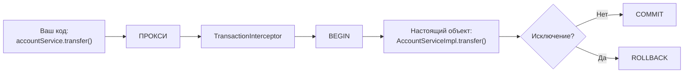
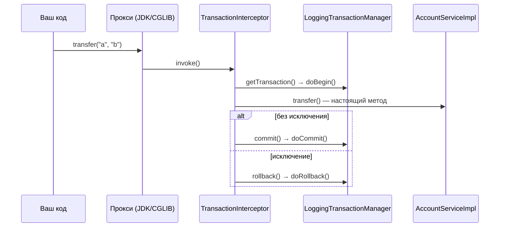

# 05. AOP-прокси: @Transactional, JDK vs CGLIB и ловушка самовызова

**Что показывает модуль:** как `@Transactional` превращает вызов метода в транзакцию, почему бин в runtime — не ваш класс, и почему `this.transfer()` молча отменяет всю магию. Транзакции видны без базы данных: самописный `LoggingTransactionManager` печатает `BEGIN`/`COMMIT`/`ROLLBACK`.

---

## Концепция

В модуле 04 мы подменяли бин проксим руками. Spring AOP делает то же самое автоматически: авто-проксировщик (тот самый `InfrastructureAdvisorAutoProxyCreator` из отчёта модуля 04) видит `@Transactional` и оборачивает бин прокси с `TransactionInterceptor`.



Два вида прокси:

| | JDK-прокси | CGLIB-прокси |
|---|---|---|
| Механизм | Реализует интерфейс бина | Наследуется от класса бина |
| Требование | Нужен интерфейс | Нужен не-final класс и методы |
| Класс в runtime | `jdk.proxyN.$ProxyNN` | `ReportService$$SpringCGLIB$$0` |

**Важно:** Spring Boot по умолчанию использует CGLIB всегда (`spring.aop.proxy-target-class=true`). В этом модуле свойство выключено, чтобы увидеть оба вида на одном приложении.

Ловушка самовызова: внутри объекта `this` — это **не прокси**, а настоящий объект. Поэтому `selfCallDemo()` → `this.transfer()` выполняется без транзакции: перехватчик просто не участвует.

## Запуск

```bash
mvn spring-boot:run
```

Ожидаемый вывод (фрагменты):

```text
accountService (есть интерфейс)
  класс: jdk.proxyN.$ProxyNN
  JDK-прокси? true | CGLIB-прокси? false
reportService (без интерфейса)
  класс: com.visualsb.aopproxies.ReportService$$SpringCGLIB$$0
  JDK-прокси? false | CGLIB-прокси? true

=== 1. transfer(): нормальный вызов через прокси ===
>>> [tx] BEGIN
>>> [tx] COMMIT
Результат: перевод a -> b выполнен

=== 2. failingOperation(): исключение внутри @Transactional ===
>>> [tx] BEGIN
>>> [tx] ROLLBACK
Поймано: имитация сбоя внутри транзакции

=== 3. selfCallDemo(): this.transfer() в обход прокси ===
Результат: перевод a -> b выполнен
Обратите внимание: строк [tx] НЕ было — самовызов миновал прокси.
```

В третьем сценарии метод отработал, но **транзакции не было** — в продакшене это означает «забытый» `@Transactional` без единой ошибки в логе.

## Тест

```bash
mvn test
```

Четыре теста: типы прокси (JDK для интерфейсного бина, CGLIB для классового), успешный метод даёт `begin → commit`, исключение даёт `begin → rollback`, а самовызов — **пустой список событий транзакции**.

## Под капотом

Spring Boot 3.5.x (Spring Framework 6.2.x). Точки останова — по классу и методу.

### Цепочка вызова



### Точки останова

| Класс / метод | Что наблюдать |
|---|---|
| `InfrastructureAdvisorAutoProxyCreator#postProcessAfterInitialization` | Создание прокси для бина с `@Transactional` |
| `JdkDynamicAopProxy#invoke` | Перехват вызова в JDK-прокси |
| `CglibAopProxy$DynamicAdvisedInterceptor#intercept` | Перехват вызова в CGLIB-прокси |
| `TransactionInterceptor#invoke` | Точка, где начинается/завершается транзакция |
| `AbstractPlatformTransactionManager#getTransaction`, `#commit`, `#rollback` | Делегирование в наш `doBegin`/`doCommit`/`doRollback` |

### Почему самовызов не работает — на схеме

```text
Внешний вызов:   вы → ПРОКСИ → interceptor → target.transfer()   ✅ транзакция есть
Самовызов:       вы → ПРОКСИ → target.selfCallDemo()
                                  └─ this.transfer() напрямую     ❌ interceptor не участвует
```

`this` внутри `AccountServiceImpl` указывает на сам объект, а не на прокси. Обходные пути: вынести метод в другой бин (самый чистый), внедрить бин в самого себя (`@Lazy` + self-injection) или перейти на AspectJ compile-time weaving — для учебного проекта достаточно понять механику.

### Наш LoggingTransactionManager

`AbstractPlatformTransactionManager` реализует весь шаблон транзакции (propagation, read-only, таймауты), а нам оставляет три метода: `doBegin`, `doCommit`, `doRollback`. Именно так устроены настоящие `DataSourceTransactionManager` и `JpaTransactionManager` — только их `doBegin` открывает JDBC-коннекцию.

## Эксперименты

1. Уберите `spring.aop.proxy-target-class=false` — оба бина станут CGLIB-прокси (дефолт Boot), тест типов упадёт.
2. Снимите `@Transactional` с `transfer()` — строки `[tx]` исчезнут, хотя код не изменился.
3. Вызовите `failingOperation()` через `this` из другого метода — исключение будет, а ROLLBACK нет: транзакции не существовало.
4. Повесьте `@Transactional` на `selfCallDemo()` — транзакция начнётся на внешнем методе, и внутренний `this.transfer()` окажется уже внутри неё (propagation REQUIRED).

## Ключевые классы

- `InfrastructureAdvisorAutoProxyCreator` — BeanPostProcessor, создающий AOP-прокси.
- `TransactionInterceptor` — совет (advice), реализующий транзакционные границы.
- `AbstractPlatformTransactionManager` — шаблон всех менеджеров транзакций.
- `AopUtils` — `isJdkDynamicProxy`/`isCglibProxy` для проверки в runtime.

## Дальше

Блок Core завершён. Следующий блок — `02-boot/01-autoconfiguration`: как Spring Boot сам решает, какие бины создавать, по содержимому classpath.
