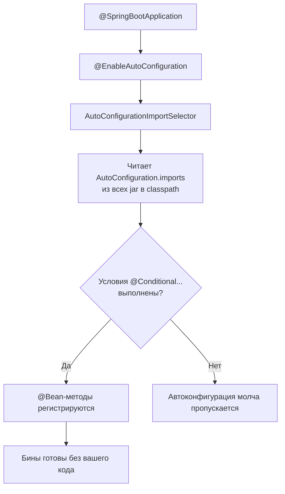
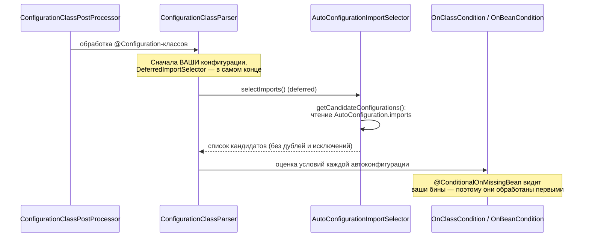

# 01. Автоконфигурация: как Spring Boot молча собирает приложение

**Что показывает модуль:** откуда Boot берёт список автоконфигураций, как они включаются по условиям и почему ваш собственный `@Bean` заставляет автоконфигурацию отступить. На примере `ObjectMapper` от Jackson — вы ничего не подключали, а бин готов.

---

## Концепция

В модуле `01-component-scan` мы разобрали первую треть `@SpringBootApplication`. Вторая — `@EnableAutoConfiguration` — импортирует `AutoConfigurationImportSelector`, который читает из каждого jar файл:

```
META-INF/spring/org.springframework.boot.autoconfigure.AutoConfiguration.imports
```

Это просто список полных имён классов автоконфигураций — более сотни только в `spring-boot-autoconfigure`. Каждый такой класс — обычная `@Configuration` с `@Bean`-методами, но снабжённая **условиями**: `@ConditionalOnClass`, `@ConditionalOnMissingBean` и другими.



Главное правило Boot: **автоконфигурация никогда не спорит с пользователем**. Если вы объявили свой `ObjectMapper`, условие `@ConditionalOnMissingBean` перестаёт выполняться — и Boot отступает, оставляя ваш бин.

В этом модуле `AppConfig` объявляет свой `ObjectMapper` с `INDENT_OUTPUT`. Поэтому `jacksonObjectMapper` от автоконфигурации в контексте отсутствует, а JSON печатается с отступами — видно, чей маппер используется.

## Запуск

```bash
mvn spring-boot:run
```

Ожидаемый вывод:

```text
================ АВТОКОНФИГУРАЦИЯ ================
Классов в списке AutoConfiguration.imports: 156
Примеры из списка:
  org.springframework.boot.autoconfigure.admin.SpringApplicationAdminJmxAutoConfiguration
  org.springframework.boot.autoconfigure.amqp.RabbitAutoConfiguration
  org.springframework.boot.autoconfigure.aop.AopAutoConfiguration

Бины типа ObjectMapper: [objectMapper]
jacksonObjectMapper (от автоконфигурации) в контексте: false
Наш objectMapper с INDENT_OUTPUT? true
Сериализация нашим маппером:
{
  "module" : "autoconfiguration",
  "magic" : "разоблачена"
}
=================================================
```

### Отчёт об условиях без Actuator

Запустите с флагом `--debug`:

```bash
mvn spring-boot:run -Dspring-boot.run.arguments=--debug
```

В консоли появится `CONDITIONS EVALUATION REPORT`: для каждой автоконфигурации — почему она сработала или нет. Реальный фрагмент из запуска этого модуля:

```text
JacksonAutoConfiguration.JacksonObjectMapperConfiguration#jacksonObjectMapper:
   Did not match:
      - @ConditionalOnMissingBean (types: com.fasterxml.jackson.databind.ObjectMapper;
        SearchStrategy: all) found beans of type 'ObjectMapper' objectMapper (OnBeanCondition)
```

Boot прямо пишет: бин не создан, потому что наш `objectMapper` уже есть. Это самый быстрый способ ответить на вопрос «почему Boot создал (или не создал) этот бин».

## Тест

```bash
mvn test
```

Четыре теста: в основном приложении работает наш маппер (автоконфигурация отступила); на изолированных контекстах через `ApplicationContextRunner` — автоконфигурация создаёт `jacksonObjectMapper`, когда своего бина нет, и не создаёт, когда есть; файл `AutoConfiguration.imports` действительно содержит `JacksonAutoConfiguration`.

## Под капотом

Spring Boot 3.5.x. Точки останова — по классу и методу.

### Цепочка импорта



### Точки останова

| Класс / метод | Что наблюдать |
|---|---|
| `AutoConfigurationImportSelector#selectImports` | Старт выбора автоконфигураций |
| `AutoConfigurationImportSelector#getCandidateConfigurations` | Чтение imports-файла, полный список кандидатов |
| `ConfigurationClassParser$DeferredImportSelectorHandler#process` | Почему автоконфигурации обрабатываются последними |
| `OnBeanCondition#getMatchResult` | Решение `@ConditionalOnMissingBean`: поиск существующих бинов |
| `ConditionEvaluationReport` | Здесь накапливаются причины — то, что печатает `--debug` |

### Почему порядок имеет значение

`AutoConfigurationImportSelector` — `DeferredImportSelector`: его импорты обрабатываются **после** всех пользовательских конфигураций. Иначе `@ConditionalOnMissingBean` не видел бы ваши бины и автоконфигурация перезаписывала бы их. Отступление — следствие порядка обработки, а не магии.

### До Boot 2.7 был другой файл

В старых версиях список жил в `META-INF/spring.factories`. Если встретите его в статьях — это та же идея, старый формат. С Boot 3.x актуален только `AutoConfiguration.imports`.

## Эксперименты

1. Удалите `@Bean objectMapper()` из `AppConfig` — автоконфигурация создаст `jacksonObjectMapper`, и JSON станет компактным (без отступов).
2. В `--debug`-выводе найдите любую автоконфигурацию, которая НЕ сработала из-за отсутствующего класса (`@ConditionalOnClass did not find required class`) — например, веб- или JDBC-конфигурации: их классов нет в classpath этого модуля.
3. Добавьте `spring-boot-starter-web` в pom и повторите запуск — список сработавших автоконфигураций вырастет (MVC, Tomcat, Jackson для HTTP) без единой строчки вашего кода.
4. Поставьте брейкпоинт в `getCandidateConfigurations` и посмотрите полный список кандидатов — потом сравните с итоговым отчётом условий.
5. Уберите зависимость `spring-web` из pom — `jacksonObjectMapper` перестанет создаваться, хотя `jackson-databind` останется в classpath: `@Bean`-метод маппера живёт во вложенной конфигурации с `@ConditionalOnClass(Jackson2ObjectMapperBuilder.class)`, а этот класс находится в spring-web. Автоконфигурация — это цепочка условий, а не один флаг.

## Ключевые классы

- `AutoConfigurationImportSelector` — выбирает автоконфигурации по imports-файлу.
- `Condition` / `OnClassCondition` / `OnBeanCondition` — реализации условий.
- `ConditionEvaluationReport` — журнал решений (источник `--debug`-отчёта).
- `ApplicationContextRunner` + `AutoConfigurations` — тестирование автоконфигураций на изолированных контекстах.

## Дальше

`02-boot/02-conditional`: пишем свои условия — `@ConditionalOnProperty`, `@ConditionalOnClass`, кастомный `Condition`.
