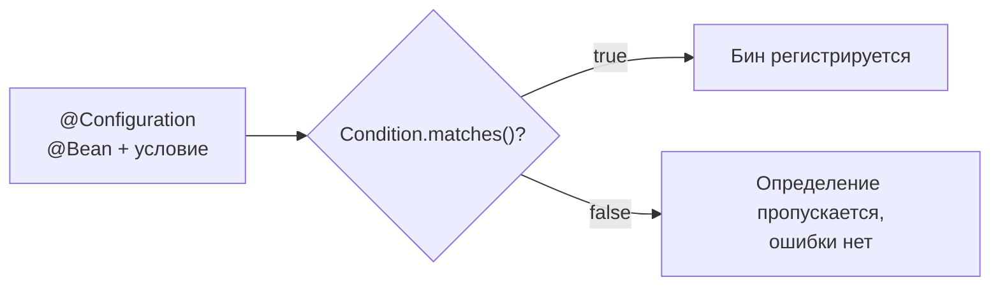

# 02. Условная регистрация бинов: @ConditionalOn... и свой Condition

**Что показывает модуль:** как бин появляется или исчезает по правилам — значение property, наличие класса в classpath, произвольное условие. Это механизм, на котором стоит вся автоконфигурация из модуля 01.

---

## Концепция

Условие — это вопрос «создавать ли бин?», заданный **до** регистрации. Spring Boot предоставляет готовые условия, а интерфейс `Condition` позволяет написать своё.

| Условие в примере | Бин | Когда создаётся |
|---|---|---|
| `@ConditionalOnProperty(prefix="feature.notifications", name="enabled", havingValue="true")` | `notificationService` | `feature.notifications.enabled=true` |
| `@ConditionalOnClass(ObjectMapper.class)` | `jacksonReportService` | Jackson есть в classpath |
| `@Conditional(OnFullModeCondition.class)` | `advancedModeService` | Системное свойство `demo.mode=full` |



Ключевое отличие от `if` в коде: решение принимается на уровне **метаданных** (модуль 02-core) — класс бина может даже не загружаться в JVM, если условие не выполнено.

## Запуск

```bash
mvn spring-boot:run
```

```text
================ УСЛОВНАЯ РЕГИСТРАЦИЯ БИНОВ ================
feature.notifications.enabled=true  -> notificationService: true
Jackson в classpath                 -> jacksonReportService: true
demo.mode=full (не задан)           -> advancedModeService: false

Включить расширенный режим: -Ddemo.mode=full
Выключить уведомления: --feature.notifications.enabled=false
Причины решений: запуск с --debug (CONDITIONS EVALUATION REPORT)
===========================================================
```

Попробуйте варианты:

```bash
mvn spring-boot:run -Dspring-boot.run.arguments=--feature.notifications.enabled=false
mvn spring-boot:run -Dspring-boot.run.jvmArguments=-Ddemo.mode=full
mvn spring-boot:run -Dspring-boot.run.arguments=--debug
```

## Тест

```bash
mvn test
```

Четыре теста на `ApplicationContextRunner`: property включает/выключает бин; `FilteredClassLoader(ObjectMapper.class)` имитирует отсутствие Jackson **без изменения pom**; кастомное условие проверяется с системным свойством и без. Плюс проверка набора бинов в основном приложении.

## Под капотом

### Где вычисляются условия

`ConditionEvaluator#shouldSkip` вызывается при разборе конфигураций (`ConfigurationClassParser`) и при регистрации `@Bean`-методов. Условия на классах-конфигурациях и на методах работают независимо — поэтому автоконфигурации Boot часто вкладывают друг в друга (см. эксперимент 5 модуля 01).

### Точки останова

| Класс / метод | Что наблюдать |
|---|---|
| `ConditionEvaluator#shouldSkip` | Входная точка оценки любого условия |
| `OnPropertyCondition#getMatchOutcome` | Чтение property, сравнение с havingValue |
| `OnClassCondition#match` | Проверка класса по имени, без загрузки в JVM |
| `OnFullModeCondition#matches` | Наше условие: `ConditionContext` даёт доступ к environment, beanFactory, classLoader |

### ConditionContext — что доступно условию

Из `ConditionContext` можно достать `Environment` (properties, профили), `ConfigurableListableBeanFactory` (какие бины уже есть), `ClassLoader` и `ResourceLoader`. Поэтому кастомное условие может проверять что угодно: версию Java, ОС, наличие файла, значение в БД.

### matchIfMissing

У `@ConditionalOnProperty` есть `matchIfMissing`: если property не задано, условие считается выполненным. Так Boot включает фичи «по умолчанию включено, выключить можно». В нашем примере флаг не задан — уведомления исчезнут при отсутствии property.

## Эксперименты

1. Добавьте `matchIfMissing = true` к `@ConditionalOnProperty` и уберите property из `application.properties` — бин останется.
2. Задайте `havingValue` без значения `true` (пустой) — условие будет срабатывать на любое значение, кроме `false`.
3. Напишите условие `OnJava21Condition` через `System.getProperty("java.version")` и подключите к новому бину.
4. Найдите своё условие в `--debug`-отчёте: у `advancedModeService` будет `Did not match` с указанием нашего класса условия.

## Ключевые классы

- `Condition` / `ConditionContext` — интерфейс и контекст кастомных условий.
- `OnPropertyCondition`, `OnClassCondition`, `OnBeanCondition` — готовые реализации Boot.
- `ConditionEvaluator` — движок оценки.
- `FilteredClassLoader` — тестирование «класса нет» без правки зависимостей.

## Дальше

`03-starters`: упакуем автоконфигурацию и условия в собственный стартер.
