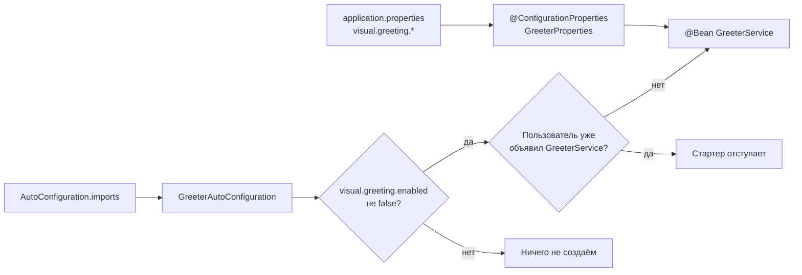

# 03. Собственный starter: автоконфигурация как готовый опыт

**Что показывает модуль:** приложение вообще не объявляет `GreeterService`, но получает его из подключённого стартера. Одновременно работают биндинг свойств, выключатель и возможность заменить бин стартера своим.

---

## Концепция

**Starter** — это удобная упаковка зависимостей и автоконфигурации, а не аннотация и не особый тип артефакта. В простейшем случае стартер — JAR с зависимостями и автоконфигурацией: приложение добавляет его в classpath, Boot находит описанные в нём настройки и создаёт бины.

Официальные `spring-boot-starter-*` подтягивают нужные библиотеки; автоконфигурация находится в `spring-boot-autoconfigure`. Собственный стартер обычно разделяют на `acme-spring-boot-autoconfigure` (условия, properties, бины) и `acme-spring-boot-starter` (зависимость на первый модуль и нужные библиотеки). Здесь обе части намеренно лежат в одном учебном модуле, чтобы путь от imports-файла до бина можно было увидеть целиком.



## Анатомия этого стартера

1. **`GreeterProperties`** с `@ConfigurationProperties("visual.greeting")` превращает `visual.greeting.message` и `visual.greeting.name` в типизированный объект с значениями по умолчанию.
2. **`GreeterService`** — обычный класс, который получает готовый объект настроек через конструктор.
3. **`GreeterAutoConfiguration`** с `@AutoConfiguration` регистрирует сервис. `@EnableConfigurationProperties` включает биндинг, `@ConditionalOnProperty` даёт выключатель, `@ConditionalOnMissingBean` уступает пользовательскому бину.
4. **`src/main/resources/META-INF/spring/org.springframework.boot.autoconfigure.AutoConfiguration.imports`** содержит полное имя автоконфигурации. В Boot 3 используется этот файл, а не старый `spring.factories` для регистрации автоконфигураций.

Класс находится в пакете `com.visualsb.starters.starter`: он ниже пакета приложения, но это **не** причина его регистрации. Автоконфигурация не полагается на component scan — именно поэтому её можно использовать из другого JAR.

## Запуск

```bash
mvn spring-boot:run
```

```text
================ СОБСТВЕННЫЙ СТАРТЕР ================
В приложении НЕТ конфигурации для greeterService —
его создала GreeterAutoConfiguration из нашего AutoConfiguration.imports.
greet(): Привет из собственного стартера, Visual SB!
visual.greeting.name задано в application.properties (биндинг @ConfigurationProperties).
Выключить: visual.greeting.enabled=false. Свой @Bean GreeterService -> стартер отступит.
====================================================
```

Отключите автоконфигурацию и убедитесь, что приложение больше не запускается: `StarterReportRunner` требует отсутствующий `GreeterService`, поэтому Spring явно покажет ошибку внедрения.

```bash
mvn spring-boot:run -Dspring-boot.run.arguments=--visual.greeting.enabled=false
```

Измените приветствие без перекомпиляции:

```bash
mvn spring-boot:run -Dspring-boot.run.arguments="--visual.greeting.message=Салют --visual.greeting.name=Spring"
```

## Тест

```bash
mvn test
```

Пять тестов проверяют основное приложение, значения по умолчанию, выключение по property, биндинг двух свойств и отступление перед пользовательским `@Bean`. Изолированные сценарии используют `ApplicationContextRunner`: он не поднимает сервер и позволяет исследовать автоконфигурацию отдельно от приложения.

## Под капотом

| Класс / метод | Что наблюдать |
|---|---|
| `ImportAutoConfigurationImportSelector#selectImports` | Имена кандидатов читаются из `AutoConfiguration.imports` |
| `AutoConfigurationImportSelector` | Фильтрация, сортировка и исключения автоконфигураций |
| `ConfigurationPropertiesBinder` | Привязка `visual.greeting.*` к `GreeterProperties` |
| `OnPropertyCondition#getMatchOutcome` | `matchIfMissing=true`: отсутствие флага означает «включено» |
| `OnBeanCondition` | `@ConditionalOnMissingBean` видит пользовательский бин и пропускает наш |
| `GreeterAutoConfiguration#greeterService` | Момент создания обычного, не «волшебного» бина |

`@ConditionalOnMissingBean` работает с уже обработанными определениями, поэтому порядок разбора конфигураций имеет значение. Boot обрабатывает автоконфигурации после пользовательских; собственные условия на наличие бина размещайте именно в автоконфигурации. Порядок между несколькими автоконфигурациями при необходимости задают `@AutoConfigureAfter` / `@AutoConfigureBefore`.

## Эксперименты

1. Временно уберите строку из imports-файла. `GreeterAutoConfiguration` останется в проекте, но бин исчезнет — component scan её не подхватывает.
2. Уберите `@ConditionalOnMissingBean` и запустите тест `userBeanMakesStarterBackOff`: контекст получит два кандидата и тест перестанет быть зелёным.
3. Добавьте `@ConditionalOnClass` для необязательной библиотеки и воспроизведите её отсутствие через `FilteredClassLoader`, как в предыдущем модуле.
4. Вынесите пакет `starter` в отдельный JAR, а зависимости перенесите в тонкий starter — так получится структура, пригодная для публикации.
5. Добавьте `@Validated` и ограничения к properties, чтобы ошибка конфигурации обнаруживалась при старте, а не при первом вызове сервиса.

## Ключевые классы

- `AutoConfigurationImportSelector` — импорт и фильтрация автоконфигураций.
- `EnableConfigurationProperties` / `ConfigurationPropertiesBinder` — регистрация и биндинг настроек.
- `ConditionalOnProperty` / `ConditionalOnMissingBean` — управляемые и необязательные бины.
- `ApplicationContextRunner` — быстрые проверки поведения стартера в изоляции.

## Дальше

`04-conditions-report`: увидим положительные и отрицательные решения автоконфигурации через Actuator, а не только по логам.
