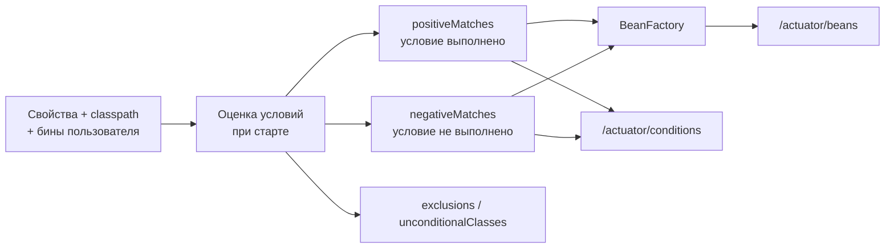

# 04. Conditions report: почему Boot создал (или не создал) бин

**Что показывает модуль:** как через HTTP посмотреть решения автоконфигурации и фактический список бинов. `visual.report.detailed` намеренно не задано, поэтому наш `detailedReportService` попадает в `negativeMatches`.

---

## Концепция

`--debug` печатает отчёт в консоль при запуске. Actuator предоставляет похожую диагностику уже работающего приложения: `/actuator/conditions` объясняет решения, а `/actuator/beans` показывает результат в контексте.



`positiveMatches` — не гарантия создания каждого возможного бина: условие может быть снято на ранней фазе, другое условие ниже — не пройти. Сопоставляйте отчёт с `/actuator/beans`.

## Запуск

```bash
mvn spring-boot:run
```

```text
================ ACTUATOR: РЕШЕНИЯ BOOT ================
http://localhost:8080/actuator/conditions -> positiveMatches / negativeMatches
http://localhost:8080/actuator/beans      -> фактические бины контекста
http://localhost:8080/actuator/health     -> состояние приложения
visual.report.detailed не задан -> detailedReportService в negativeMatches.
Эти endpoint'ы раскрыты только для локального учебного примера.
Сервер остаётся запущенным. Остановка: Ctrl+C.
========================================================
```

В другом терминале:

```bash
curl http://localhost:8080/actuator/conditions
curl http://localhost:8080/actuator/beans
curl http://localhost:8080/actuator/health
```

JSON большой — найдите в conditions ключи `WebMvcAutoConfiguration` и `ReportConfiguration#detailedReportService`. В ответе Boot 3.5 они **не** содержат полное имя пакета, в отличие от записей `--debug`.

Упрощённый фрагмент реального ответа:

```json
{
  "contexts": {
    "conditions-report": {
      "positiveMatches": {
        "WebMvcAutoConfiguration": [
          { "condition": "OnClassCondition", "message": "... DispatcherServlet ..." }
        ]
      },
      "negativeMatches": {
        "ReportConfiguration#detailedReportService": [
          { "condition": "OnPropertyCondition", "message": "... visual.report.detailed ..." }
        ]
      }
    }
  }
}
```

Сообщения условий содержат конкретные причины. Многоточия здесь — сокращение документации, а не буквальный вывод.

Для включения второго бина:

```bash
mvn spring-boot:run -Dspring-boot.run.arguments=--visual.report.detailed=true
```

Теперь `detailedReportService` появится в `/actuator/beans`, а старый negative match исчезнет.

## Тест

```bash
mvn test
```

Три теста поднимают приложение на **случайном свободном порту** и делают настоящие HTTP-запросы через `TestRestTemplate`: читают positive/negative matches, проверяют наличие обычного и отсутствие детального бина, запрашивают health. Порт 8080 для тестов не нужен.

## Под капотом

| Класс / метод | Что наблюдать |
|---|---|
| `ConditionEvaluationReport` | Накопленные исходы условий и исключённые автоконфигурации |
| `ConditionEvaluationReport#getConditionAndOutcomesBySource` | Карта «источник → оценки условий» |
| `ConditionsReportEndpoint#conditions` | Формирование отчёта по контекстам приложения |
| `BeansEndpoint#beans` | Снимок определений бинов с типами, scope и зависимостями |
| `OnPropertyCondition#getMatchOutcome` | Наш отрицательный исход до остановки на точке отчёта |

Конфигурация `ReportConfiguration` содержит два `@Bean`-метода одного Java-типа `ReportService`, но с разными именами. Имя метода по умолчанию становится именем бина, поэтому `reportService` и `detailedReportService` можно различить в отчёте. Внедрение по типу без выбора имени в таком примере было бы неоднозначным.

### Безопасность

`beans` и `conditions` раскрывают внутреннее устройство приложения, а health с `show-details=always` — детали инфраструктуры. Настройки проекта предназначены **только для локального обучения**. В production публикуйте минимально необходимые endpoint'ы, защищайте их и не показывайте детали health всем. Добавление Actuator само по себе не публикует все endpoint'ы: по умолчанию через web доступен health; остальные мы явно перечислили в `management.endpoints.web.exposure.include`.

## Эксперименты

1. Включите `visual.report.detailed=true` и найдите бин в `/actuator/beans`.
2. Уберите `conditions` из expose-списка: endpoint получит 404, хотя класс отчёта может остаться в контексте.
3. Запустите модуль `01-autoconfiguration` с `--debug` и сравните формат ключей с JSON Actuator.
4. Добавьте собственный бин с `@ConditionalOnMissingBean`, затем замените его пользовательским и проследите исход.
5. Добавьте профиль и сравните `/actuator/conditions` в разных запусках.

## Ключевые классы

- `ConditionsReportEndpoint` и `BeansEndpoint` — диагностические endpoint'ы Actuator.
- `ConditionEvaluationReport` — данные о принятых решениях.
- `TestRestTemplate` — проверка работающего HTTP-сервера из теста.

## Дальше

`03-web/01-dispatcher-servlet`: проследим, что происходит с HTTP-запросом после попадания в приложение.
