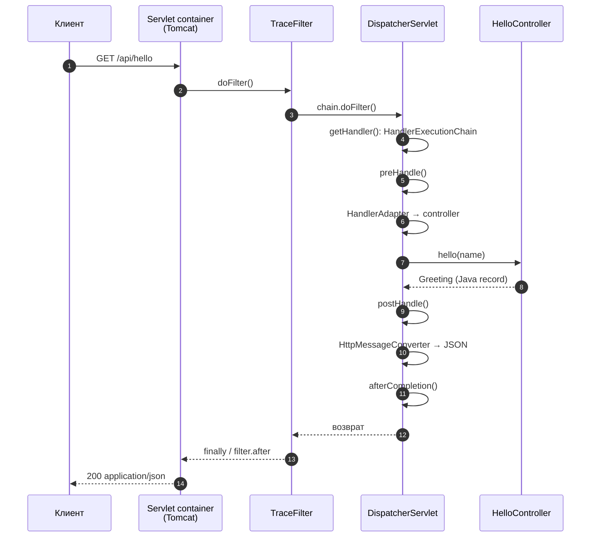

# 01. DispatcherServlet: путь HTTP-запроса

**Что показывает модуль:** запрос проходит servlet-фильтр, затем `DispatcherServlet` выбирает контроллер, вызывает interceptor, связывает параметр и превращает Java-объект в JSON. Все шесть событий видны в реальном ответе приложения.

---

## Концепция

`DispatcherServlet` — центральный диспетчер Spring MVC: он не пишет бизнес-логику сам, а координирует специализированные компоненты.



Фильтр работает **вокруг** `DispatcherServlet` и не знает, какой контроллер будет выбран. Interceptor работает уже внутри MVC и получает `handler`; наш зарегистрирован только для `/api/**`.

## Запуск

```bash
mvn spring-boot:run
```

```text
================ ПУТЬ HTTP-ЗАПРОСА ================
curl http://localhost:8080/api/hello
curl http://localhost:8080/internal/trace
Ожидаемый порядок:
filter.before -> preHandle -> controller
-> postHandle -> afterCompletion -> filter.after
DispatcherServlet: doDispatch; JSON: MappingJackson2HttpMessageConverter
Сервер остаётся запущенным. Остановка: Ctrl+C.
===================================================
```

В другом терминале:

```bash
curl http://localhost:8080/api/hello
curl http://localhost:8080/internal/trace
```

Первый ответ:

```json
{"message":"Привет, Spring MVC!"}
```

После него `/internal/trace` возвращает:

```json
["1. filter.before","2. interceptor.preHandle","3. controller","4. interceptor.postHandle","5. interceptor.afterCompletion","6. filter.after","1. filter.before"]
```

Последний `filter.before` относится к самому `/internal/trace`: в момент формирования ответа этот запрос ещё не вышел из фильтра. Это не лишний шаг первого запроса, а ещё одно свидетельство порядка «вложенных» вызовов.

Добавьте `?name=Visual SB`: параметр свяжется с аргументом контроллера без ручного парсинга URL.

## Тест

```bash
mvn test
```

Три теста используют `MockMvc`: проверяют связывание query-параметра и JSON, точную последовательность событий, ответ 404 для неизвестного пути. `MockMvc` выполняет реальную цепочку MVC в тестовом servlet-окружении, но не открывает сетевой порт; отдельный запуск с `curl` выше проверяет настоящий Tomcat.

## Под капотом

### Главный алгоритм

Откройте `DispatcherServlet#doDispatch` и проследите основные переменные:

1. `getHandler(processedRequest)` опрашивает `HandlerMapping`. Для `@GetMapping` основную работу делает `RequestMappingHandlerMapping`.
2. `getHandlerAdapter(...)` выбирает `RequestMappingHandlerAdapter`, который умеет вызвать метод контроллера.
3. `mappedHandler.applyPreHandle(...)` вызывает interceptors. Если `preHandle` возвращает `false`, цепочка останавливается.
4. `ha.handle(...)` вызывает контроллер через `InvocableHandlerMethod`.
5. `HandlerMethodReturnValueHandler` и `HttpMessageConverter` сериализуют результат. Для нашего record — `MappingJackson2HttpMessageConverter`.
6. `applyPostHandle`, `processDispatchResult`, `triggerAfterCompletion` завершают обработку.

| Точка останова | Что наблюдать |
|---|---|
| `DispatcherServlet#doDispatch` | `mappedHandler`, `handlerAdapter`, `ModelAndView` |
| `RequestMappingHandlerMapping#lookupHandlerMethod` | Сопоставление URL и HTTP-метода с `@GetMapping` |
| `InvocableHandlerMethod#invokeForRequest` | Аргумент `name` уже получен из запроса |
| `AbstractMessageConverterMethodProcessor#writeWithMessageConverters` | Выбор media type и converter |
| `TraceFilter#doFilterInternal` | Контроллер находится внутри `chain.doFilter` |
| `TraceInterceptor#afterCompletion` | Завершение после основной обработки, включая ошибки |

### Границы упрощения

`RequestTrace` — singleton со списком событий **только для последовательных учебных запросов**. При параллельных запросах события разных клиентов перемешаются; в реальном приложении используйте request scope или диагностический контекст, а не общий неограниченный список. `@Order(1)` задаёт порядок нашего фильтра относительно других, но фильтры Boot и Servlet container могут выполняться до него. `postHandle` не вызывается при некоторых исключениях, а `afterCompletion` предназначен для завершения цепочки.

## Эксперименты

1. Верните `false` из `preHandle`: контроллер не вызовется, `postHandle` тоже не появится.
2. Бросьте исключение в контроллере и добавьте `@RestControllerAdvice`: сравните обработку ошибки и вызовы interceptor.
3. Добавьте второй interceptor и задайте порядок: `preHandle` выполняется в прямом порядке, завершающие callback'и — в обратном.
4. Верните `ResponseEntity<Greeting>` со статусом 201: механизм converter останется тем же.
5. Включите `logging.level.org.springframework.web.servlet.mvc.method.annotation=TRACE` и посмотрите отображение handler method.

## Ключевые классы

- `DispatcherServlet` — координация обработки запроса.
- `RequestMappingHandlerMapping` / `RequestMappingHandlerAdapter` — выбор и вызов контроллера.
- `HandlerInterceptor` — callback'и вокруг handler внутри MVC.
- `OncePerRequestFilter` — фильтр вокруг всей диспетчеризации.
- `HttpMessageConverter` — преобразование Java-объекта в представление ответа.

## Дальше

`04-data/01-jpa-transactions`: как вызов сервиса оборачивается транзакцией и почему INSERT исчезает после исключения.
