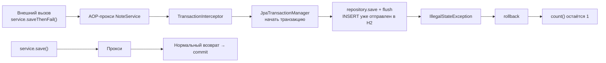

# 01. Spring Data JPA и транзакции: где живёт rollback

**Что показывает модуль:** репозиторий — интерфейс без нашей реализации, сервис — AOP-прокси, а INSERT из неуспешного метода не остаётся в базе. H2 позволяет увидеть всё без установки сервера БД.

---

## Концепция

`@Transactional` не «отменяет Java-код» и не удаляет объект из памяти. Прокси сервиса открывает транзакцию до вызова метода; после нормального возврата выполняется commit, после unchecked exception — rollback. База отменяет изменения, сделанные в рамках этой транзакции.



```java
@Transactional
public void saveThenFail(String text) {
    repository.save(new Note(text));
    repository.flush();
    throw new IllegalStateException("Демонстрационная ошибка: транзакция будет откачена");
}
```

`flush()` намеренно отправляет INSERT до исключения: так видно, что rollback не означает «SQL никогда не выполнялся».

## Запуск

```bash
mvn spring-boot:run
```

Ключевой вывод (номер динамического прокси меняется):

```text
================ JPA И ТРАНЗАКЦИИ ================
NoteRepository — интерфейс, реализация: jdk.proxy2.$Proxy97
NoteService — AOP-прокси: true
До save(): count = 0
После commit: count = 1
Поймали: Демонстрационная ошибка: транзакция будет откачена
После rollback: count = 1
DDL/SQL генерирует Hibernate; H2 хранит данные только в памяти.
=================================================
```

Между этими строками Hibernate печатает SQL благодаря `spring.jpa.show-sql=true`: `select count`, получение следующего значения последовательности, `insert into note (text,id) values (?,?)`. Значения аргументов не раскрываются этим параметром — только placeholders.

## Тест

```bash
mvn test
```

Три теста проверяют сохранение и чтение по сгенерированному ID, rollback после `IllegalStateException`, AOP-прокси сервиса и динамический прокси репозитория. Последний тест специально показывает, что объект `NoteRepository` не является напрямую `SimpleJpaRepository`.

## Под капотом

### Два разных вида «магии»

**Spring Data** при старте обнаруживает `NoteRepository extends JpaRepository<Note, Long>`. `JpaRepositoryFactory` формирует метаданные и реализацию запросов, `ProxyFactory` создаёт объект интерфейса. Базовая реализация стандартных операций — `SimpleJpaRepository`, но вы получаете не её экземпляр напрямую, а прокси с дополнительными аспектами.

**Транзакции** используют AOP из `01-core/05-aop-proxies`. `BeanFactoryTransactionAttributeSourceAdvisor` находит методы с метаданными `@Transactional`, `TransactionInterceptor` оборачивает вызов, `JpaTransactionManager` координирует транзакцию JPA.

| Точка останова | Что наблюдать |
|---|---|
| `JpaRepositoryFactory#getRepository` | Метаданные, fragments и создание proxy репозитория |
| `SimpleJpaRepository#save` | Выбор `persist` для новой сущности |
| `TransactionInterceptor#invoke` | Вызов метода внутри транзакционного аспекта |
| `TransactionAspectSupport#invokeWithinTransaction` | Ветки commit и rollback при завершении |
| `JpaTransactionManager#doBegin` | Связывание `EntityManager` и транзакции |
| `JpaTransactionManager#doRollback` | Фактический откат после исключения |

По умолчанию Spring откатывает `RuntimeException` и `Error`, но не проверяемые исключения. Правила можно явно задать `rollbackFor` / `noRollbackFor`. Самовызов `this.saveThenFail()` из другого метода того же класса минует прокси, поэтому новая транзакция не начнётся; вложенные транзакции, propagation и checked exceptions — отдельные темы, не скрытые в этом простом примере.

### Границы примера

H2 in-memory выбран для наблюдения механизма, а не для сравнения всех особенностей production-СУБД. `spring.jpa.show-sql=true` полезен локально, но обычно не заменяет нормальные логи и метрики в production. Пример короткий и синхронный: он не имитирует распределённую транзакцию или гарантии между БД и брокером сообщений.

## Эксперименты

1. Уберите `@Transactional` с `saveThenFail`: репозиторный `save` получит собственную транзакцию, а запись останется после исключения сервиса.
2. Замените `IllegalStateException` на checked exception и вызовите метод с `throws`: увидите commit по правилам по умолчанию. Затем добавьте `rollbackFor`.
3. Вызовите `saveThenFail` через `this` из другого метода: сравните поведение с модулем про прокси.
4. Добавьте `Optional<Note> findByText(String text)` в интерфейс и посмотрите, как Spring Data строит запрос из имени метода.
5. Добавьте `@Transactional(readOnly=true)` на отдельный метод чтения и исследуйте, какие подсказки получает persistence provider.

## Ключевые классы

- `JpaRepository` / `JpaRepositoryFactory` / `SimpleJpaRepository` — контракт и фабрика репозиториев.
- `TransactionInterceptor` / `TransactionAspectSupport` — AOP-обёртка транзакций.
- `JpaTransactionManager` — менеджер JPA-транзакции.
- `EntityManager` / Hibernate — управление сущностями и SQL.

## Дальше

`05-security/01-filter-chain`: увидим цепочку фильтров, которая решает, пускать ли HTTP-запрос до контроллера.
