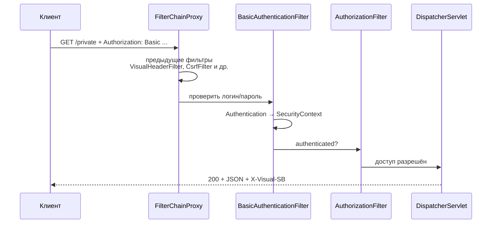

# 01. Spring Security: запрос через цепочку фильтров

**Что показывает модуль:** `/public` доступен без логина, `/private` требует HTTP Basic, а собственный фильтр добавляет `X-Visual-SB` и к успешному, и к отклонённому ответу. Полный список фильтров печатает само приложение.

---

## Концепция

Spring Security не «угадывает пользователя» в контроллере. `FilterChainProxy` выбирает подходящую `SecurityFilterChain` и передаёт запрос её фильтрам **до** `DispatcherServlet`.



Без credentials `BasicAuthenticationFilter` не аутентифицирует запрос. `AuthorizationFilter` видит отсутствие нужной аутентификации, а `ExceptionTranslationFilter` превращает отказ в ответ 401. До контроллера запрос в этом случае не доходит.

- **Аутентификация:** кто вы? Здесь — `user` / `pass` через HTTP Basic.
- **Авторизация:** что разрешено? `/public` — всем, остальное — аутентифицированным.

## Конфигурация

```java
@Bean
SecurityFilterChain securityFilterChain(HttpSecurity http) throws Exception {
    http.authorizeHttpRequests(requests -> requests
                    .requestMatchers("/public").permitAll()
                    .anyRequest().authenticated())
            .httpBasic(Customizer.withDefaults())
            .addFilterBefore(new VisualHeaderFilter(), SecurityContextHolderFilter.class);
    return http.build();
}
```

`permitAll` не выключает весь Security: фильтры всё равно выполняются, меняется решение авторизации. Пользовательский `SecurityFilterChain` заменяет стандартную конфигурацию Boot, а `spring.security.user.*` создаёт демонстрационного пользователя в памяти.

`VisualHeaderFilter` намеренно создаётся через `new` и вставляется только в security chain. Если дополнительно объявить его отдельным servlet-бином, Boot может зарегистрировать его ещё раз для всего приложения.

## Запуск

```bash
mvn spring-boot:run
```

Приложение печатает реальную цепочку для `/private` (Spring Security 6.5):

```text
================ SECURITY FILTER CHAIN ================
Фильтры для /private (от первого к последнему):
 -> DisableEncodeUrlFilter
 -> WebAsyncManagerIntegrationFilter
 -> VisualHeaderFilter
 -> SecurityContextHolderFilter
 -> HeaderWriterFilter
 -> CsrfFilter
 -> LogoutFilter
 -> BasicAuthenticationFilter
 -> RequestCacheAwareFilter
 -> SecurityContextHolderAwareRequestFilter
 -> AnonymousAuthenticationFilter
 -> ExceptionTranslationFilter
 -> AuthorizationFilter
curl http://localhost:8080/public
curl -u user:pass http://localhost:8080/private
X-Visual-SB добавляет наш фильтр; пароль только для локального примера.
Сервер остаётся запущенным. Остановка: Ctrl+C.
=======================================================
```

В другом терминале:

```bash
curl -i http://localhost:8080/public
curl -i http://localhost:8080/private
curl -i -u user:pass http://localhost:8080/private
curl -i -u user:wrong http://localhost:8080/private
```

Ожидаемые статусы: 200, 401, 200, 401. JSON защищённого ответа:

```json
{"message":"доступ разрешён","user":"user"}
```

Во всех четырёх ответах есть `X-Visual-SB: security-chain`: наш фильтр стоит раньше аутентификации и авторизации. Набор фильтров — не универсальная константа: он зависит от конфигурации и версии Security, поэтому мы получаем его через `FilterChainProxy#getFilters`, а не храним список вручную в коде.

## Тест

```bash
mvn test
```

Четыре теста `MockMvc`: публичный доступ, 401 без credentials, успешный вход с `httpBasic("user", "pass")`, отказ с неверным паролем. Также проверяются JSON и собственный header. Request postprocessor `httpBasic` находится в `spring-security-test` — это отдельная тестовая зависимость.

## Под капотом

| Класс / метод | Что наблюдать |
|---|---|
| `FilterChainProxy#doFilterInternal` | Выбор chain и создание `VirtualFilterChain` |
| `BasicAuthenticationFilter#doFilterInternal` | Декодирование `Authorization: Basic ...` |
| `ProviderManager#authenticate` | Делегирование провайдеру аутентификации |
| `DaoAuthenticationProvider#authenticate` | Пользователь и проверка пароля |
| `AuthorizationFilter#doFilter` | Решение `permitAll` / `authenticated` |
| `ExceptionTranslationFilter#doFilter` | Перевод security-исключения в 401/другой security-ответ |

`SecurityContextHolderFilter` связывает контекст с запросом, `BasicAuthenticationFilter` может наполнить его аутентификацией, `AuthorizationFilter` находится ближе к концу и проверяет право доступа. Мы вставили собственный фильтр до первого из этих трёх, поэтому он работает и для запросов, которые будут отклонены.

### Безопасность примера

`user:pass` в `application.properties` — учебные, открыто известные credentials, **не шаблон для production**. Не используйте такой подход для реальных пользователей, не храните секреты в репозитории и не передавайте HTTP Basic без HTTPS. CSRF здесь не отключён; все демонстрационные запросы — GET и не меняют состояние. Для изменяющих endpoint'ов нужно отдельно спроектировать CSRF-защиту или обоснованно выбрать другую модель безопасности. Этот модуль показывает механику chain, а не готовую систему регистрации пользователей.

## Эксперименты

1. Уберите `addFilterBefore`: собственный header исчезнет, но правила доступа не изменятся.
2. Добавьте `.requestMatchers("/admin").hasRole("ADMIN")` и исследуйте 403 у аутентифицированного пользователя без роли.
3. Измените порядок собственного фильтра, например вставьте его после `BasicAuthenticationFilter`.
4. Добавьте POST-endpoint и сравните запрос с CSRF-token и без него, не отключая защиту без объяснения причины.
5. Добавьте второй `SecurityFilterChain` с `@Order` и собственным `securityMatcher`: проследите выбор цепочки по URL.

## Ключевые классы

- `FilterChainProxy` / `SecurityFilterChain` — выбор и представление цепочки безопасности.
- `BasicAuthenticationFilter` / `ProviderManager` — HTTP Basic и аутентификация.
- `SecurityContextHolder` — доступ к текущей аутентификации.
- `AuthorizationFilter` / `ExceptionTranslationFilter` — авторизация и security-ответы при отказе.
- `OncePerRequestFilter` — основа нашего небольшого фильтра.

## Что дальше

Это последний модуль текущей карты. Возвращайтесь к `01-core/05-aop-proxies`, чтобы связать прокси и транзакции, или к `03-web/01-dispatcher-servlet`, чтобы увидеть, где security chain заканчивается и начинается MVC.
