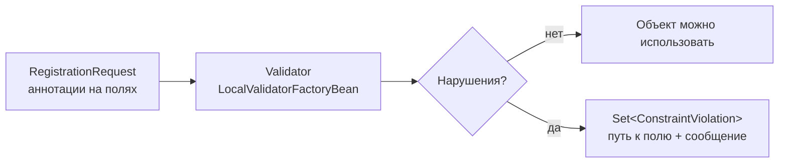
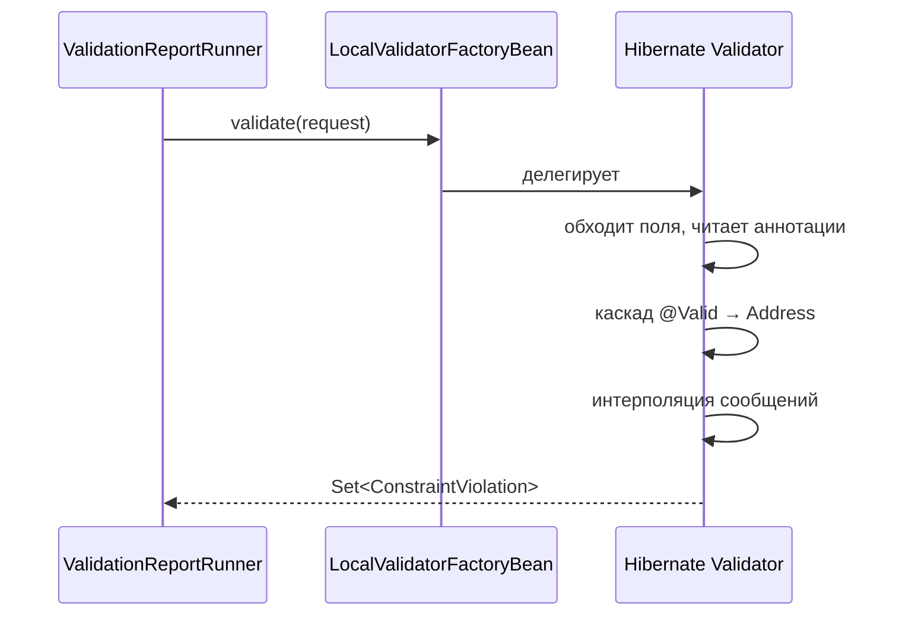

# 02. Bean Validation: данные под контролем до бизнес-логики

**Что показывает модуль:** стандарт Jakarta Bean Validation в действии — ограничения на полях DTO, каскадная проверка вложенных объектов через `@Valid`, интерполяция сообщений и собственный `ConstraintValidator`. Валидация вызывается напрямую через бин `Validator`, чтобы механика была видна без веб-слоя.

---

## Концепция

Проверять входные данные вручную в каждом методе — скучно и ненадёжно. Bean Validation предлагает декларативный контракт: ограничения объявлены аннотациями на самом классе данных, а проверяет их единый движок:



Ключевая идея: класс данных сам описывает свои инварианты. В веб-приложении тот же движок вызывает Spring MVC по аннотации `@Valid` на аргументе контроллера (модуль 03-web) — здесь мы вызываем его руками, чтобы видеть каждый шаг.

В модуле три уровня сложности:

- **встроенные ограничения** — `@NotBlank`, `@Size`, `@Email`, `@Min/@Max`, `@Pattern`;
- **каскад** — поле `address` помечено `@Valid`, поэтому проверяется и вложенный `Address`;
- **собственное ограничение** — `@StrongPassword` с классом `StrongPasswordValidator`.

## Запуск

```bash
mvn spring-boot:run
```

```text
================ BEAN VALIDATION: ДАННЫЕ ПОД КОНТРОЛЕМ ================
Валидный запрос: 0 нарушений
Невалидный запрос: 6 нарушений
  address.city -> город обязателен
  address.zipCode -> индекс: ровно 6 цифр
  age -> регистрация с 18 лет
  email -> некорректный email: 'not-an-email'
  password -> пароль: минимум 8 символов, хотя бы одна цифра и заглавная буква
  username -> имя пользователя: от 3 до 20 символов
======================================================================
```

## Тест

```bash
mvn test
```

Четыре теста: валидный запрос проходит без нарушений; невалидный даёт ровно шесть ожидаемых путей; каскад через `@Valid` добирается до `address.city`; собственный валидатор отклоняет три вида слабых паролей и пропускает сильный.

## Под капотом

Spring Boot 3.5.x, Hibernate Validator 8.x (единственная реализация Jakarta Bean Validation в Boot). Точки останова — по классу и методу.

### Откуда берётся бин Validator

`spring-boot-starter-validation` подтягивает Hibernate Validator, а автоконфигурация `ValidationAutoConfiguration` создаёт `LocalValidatorFactoryBean` — адаптер, который реализует одновременно `jakarta.validation.ValidatorFactory` и Spring-овый `org.springframework.validation.Validator`. Поэтому `Validator` можно просто внедрить.

### Как интерполируются сообщения

Строка `"имя пользователя: от {min} до {max} символов"` — шаблон. `ResourceBundleMessageInterpolator` подставляет атрибуты аннотации (`{min}`, `{max}`), выражение `'${validatedValue}'` — это Jakarta EL, оно показывает само отклонённое значение. Порядок вызова:



### Точки останова

| Класс / метод | Что наблюдать |
|---|---|
| `ValidationAutoConfiguration` | Как создаётся `LocalValidatorFactoryBean` |
| `ValidatorImpl#validate` (Hibernate Validator) | Обход полей бина и сбор нарушений |
| `StrongPasswordValidator#isValid` | Ваш код внутри общего механизма — обычный вызов из движка |
| `ConstraintViolation#getPropertyPath` | Путь вида `address.city` — как движок записывает вложенность |

### Почему без @Valid вложенный объект не проверяется

Каскад — opt-in: движок спускается в поле только с `@Valid`. Это осознанное решение спецификации: не всякий вложенный объект нужно проверять при каждой валидации родителя. Уберите `@Valid` с `address` — и тест `nestedObjectIsValidatedThroughValidCascade` упадёт: нарушения `address.city` исчезнут.

### Record и аннотации

Ограничения объявлены на компонентах record, а движок читает их с порождённых полей: компилятор копирует аннотацию компонента на поле, потому что `@Target` ограничений включает `FIELD`. Поэтому record — полноценный гражданин Bean Validation без лишних телодвижений.

## Эксперименты

1. Уберите `@Valid` с поля `address` — нарушения `address.city` и `address.zipCode` пропадут из вывода.
2. Добавьте `@NotNull` на `password` и передайте `null` — посчитайте, сколько теперь нарушений на одном поле.
3. Измените сообщение `@StrongPassword` на свой шаблон с `{validatedValue}` — посмотрите, как меняется вывод.
4. Добавьте группу валидации (`groups = OnCreate.class`) и вызовите `validator.validate(request, OnCreate.class)` — ограничения без группы не сработают.

## Ключевые классы

- `jakarta.validation.Validator` — точка входа движка.
- `ConstraintViolation` — одно нарушение: путь, сообщение, отклонённое значение.
- `ConstraintValidator` — интерфейс для собственных ограничений.
- `LocalValidatorFactoryBean` — мост между Hibernate Validator и Spring.

## Дальше

`03-flyway`: данные проверены — теперь о том, как управлять схемой базы, в которой они живут, без ручных SQL-скриптов «на проде».
