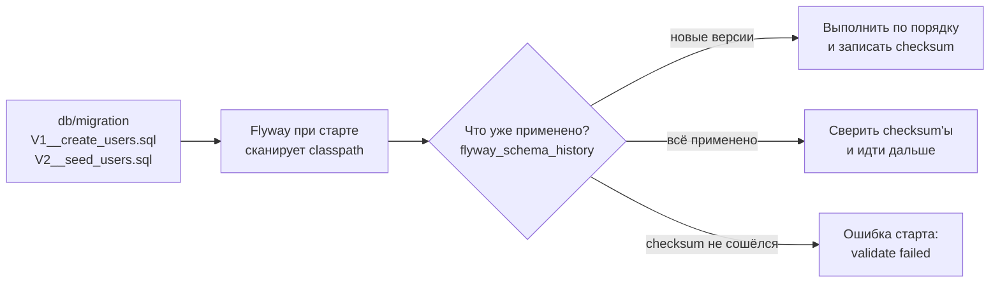
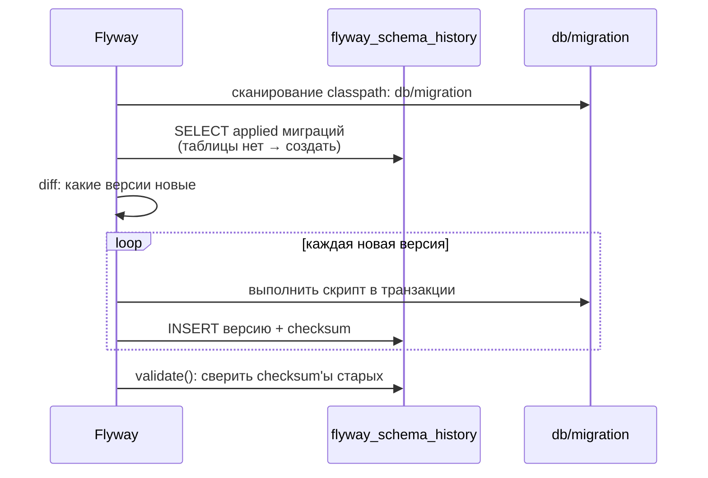

# 03. Flyway: схема базы под версионным контролем

**Что показывает модуль:** миграции Flyway на встраиваемой H2 — два скрипта из `db/migration` применяются при старте приложения, а служебная таблица `flyway_schema_history` фиксирует версию, описание и checksum каждой миграции. Тесты проверяют порядок применения, данные и защиту от правки старых скриптов.

---

## Концепция

Схема базы меняется вместе с кодом, но «просто выполнить SQL на проде» не масштабируется: непонятно, какие скрипты уже применены, в каком порядке и не изменил ли кто-то старый файл. Flyway решает это версионированием:



Правила игры:

- Имя файла — контракт: `V<версия>__<описание>.sql`, версии применяются строго по возрастанию.
- **Применённый файл больше не редактируют** — изменение ломает checksum, и Flyway отказывается стартовать. Изменения схемы — только новым файлом `V3__...`.
- Flyway в Spring Boot запускается автоматически: `FlywayAutoConfiguration` видит `flyway-core` в classpath и выполняет `migrate()` до создания остальных бинов данных.

## Запуск

```bash
mvn spring-boot:run
```

```text
================ FLYWAY: СХЕМА ПОД ВЕРСИОННЫМ КОНТРОЛЕМ ===============
Применённые миграции (flyway.info().applied()):
  V1 | create users | checksum=489991166 | SUCCESS | 18 мс
  V2 | seed users | checksum=671456904 | SUCCESS | 4 мс

Строк в users после миграций: 3
Таблица flyway_schema_history (её ведёт сам Flyway):
  V1 | create users | success=true
  V2 | seed users | success=true
======================================================================
```

(значения checksum зависят от содержимого файлов — у вас они будут такими же, пока файлы не изменены)

## Тест

```bash
mvn test
```

Три теста: обе миграции применены в порядке версий; сидированные данные на месте; `validate()` проходит, а checksum'ы записаны в историю.

## Под капотом

Spring Boot 3.5.x, Flyway 11.x (версия из BOM Spring Boot), H2 in-memory. Точки останова — по классу и методу.

### Кто запускает миграции

`FlywayAutoConfiguration` создаёт бин `Flyway` из свойств `spring.flyway.*`, а `FlywayMigrationInitializer` вызывает `flyway.migrate()` после готовности `DataSource`, но **до** любых бинов, которые работают с базой. Поэтому JPA/DAO всегда видят уже готовую схему — модуль 04-data опирается на тот же порядок.

### Что делает migrate()



### Точки останова

| Класс / метод | Что наблюдать |
|---|---|
| `FlywayAutoConfiguration` | Условия: `@ConditionalOnClass(Flyway.class)`, свойства `spring.flyway.*` |
| `Flyway#migrate` | Точка входа: diff версий и цикл применения |
| `DbMigrate#migrateGroup` (Flyway) | Выполнение одного скрипта и запись в историю |
| `Flyway#validate` | Сверка checksum — здесь рождается ошибка «checksum mismatch» |

### Почему правка старого скрипта — это катастрофа

Checksum хранится в `flyway_schema_history` вместе с версией. При каждом старте Flyway пересчитывает checksum файлов и сравнивает с записанным. Несовпадение означает: «файл, который уже применён на всех окружениях, изменили задним числом» — базы разъехались, и доверять истории больше нельзя. Поэтому старт падает. Правильный путь — новая миграция `V3__fix_users.sql`, которая чинит схему вперёд.

### Почему в раннере имена в кавычках

Flyway создаёт служебную таблицу с quoted-идентификаторами, и H2 хранит её как `flyway_schema_history` в нижнем регистре, чувствительном к регистру. Непрошенный запрос `FROM flyway_schema_history` H2 читает как `FLYWAY_SCHEMA_HISTORY` (uppercase по умолчанию) и не находит таблицу — поэтому в `FlywayReportRunner` имена обёрнуты в двойные кавычки. Эта особенность H2; в PostgreSQL та же таблица читается без кавычек.

### Flyway vs spring.sql.init и JPA ddl-auto

- `spring.sql.init.schema.sql` — выполняется при каждом старте, без версий и истории: годится для демо, не для прода.
- `hibernate.ddl-auto=update` — Hibernate сам меняет схему по entity-классам: удобно в начале, но изменения не версионируются и не ревьюятся как SQL.
- Flyway — явные версионируемые SQL-файлы в git, применяемые один раз и проверяемые checksum. В связке с JPA принято: Flyway владеет схемой, `ddl-auto=validate` только сверяет entity со схемой.

## Эксперименты

1. Добавьте `V3__add_bio_to_users.sql` с `ALTER TABLE users ADD COLUMN bio VARCHAR(200)` — при старте применится только он, история вырастет до трёх строк.
2. Измените любой символ в `V1__create_users.sql` и перезапустите — старт упадёт с `Validate failed: Migrations have failed validation` (checksum mismatch). Верните символ — всё починится.
3. Запустите два раза подряд — второй запуск не применяет ничего: миграции идемпотентны по истории.
4. Переименуйте `V2` в `V1_5__seed_users.sql` — версия `1.5` встанет между 1 и 2, но применится только на чистой базе.

## Ключевые классы

- `org.flywaydb.core.Flyway` — точка входа: `migrate()`, `info()`, `validate()`.
- `MigrationInfo` — одна запись истории: версия, описание, checksum, состояние.
- `FlywayAutoConfiguration` — автоконфигурация Spring Boot, запускающая миграции при старте.
- `flyway_schema_history` — служебная таблица, источник истины о применённых версиях.

## Дальше

Следующие кандидаты из списка зависимостей требуют внешней инфраструктуры (Redis, Kafka/RabbitMQ) или облачных паттернов (OpenFeign, Gateway, Config) — им нужен отдельный разговор о формате модулей.
